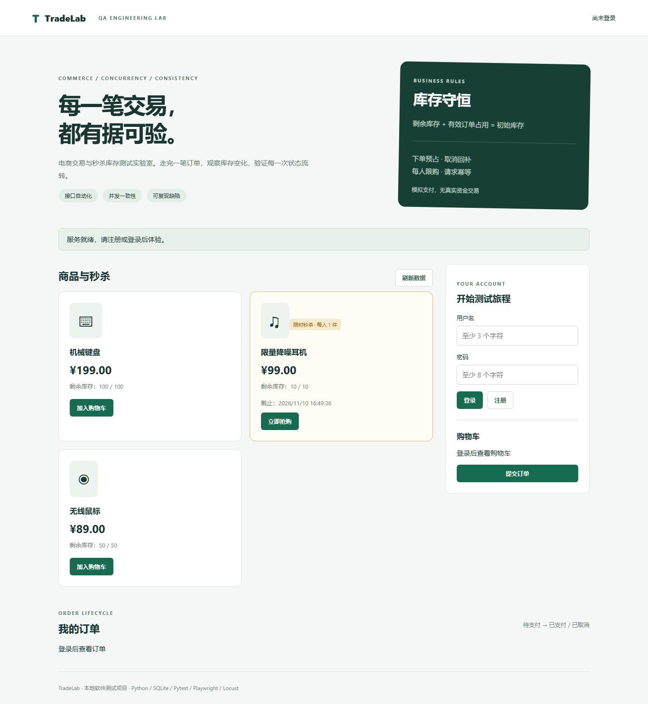
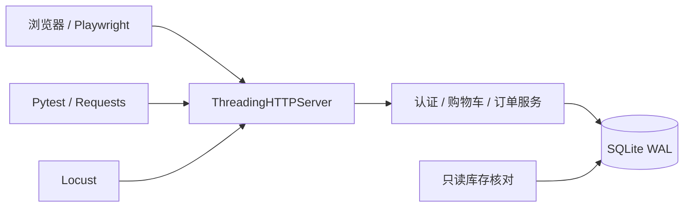

# TradeLab｜电商交易与秒杀库存系统测试实战

一个可本地运行、可复现并发缺陷、可用于面试演示的软件测试作品集。包含被测系统、接口自动化、浏览器自动化、Locust 压测、数据库一致性检查和 GitHub Actions。

本项目是个人测试实践，模拟支付不涉及真实资金。测试结果以实际运行报告为准，不虚构公司经历或线上性能指标。



## 快速开始

需要 Python 3.9 或以上版本。被测系统只使用 Python 标准库：

```bash
python -m app.server
```

打开 http://127.0.0.1:8000 ，注册一个账号（用户名 3–32 字符、密码 8–128 字符）。默认商品：机械键盘 ¥199、无线鼠标 ¥89、秒杀耳机 ¥99。秒杀库存为 10 件，数据库第一次创建时活动开始、24 小时后结束。

在 PowerShell 中建立独立环境并执行接口测试：

```powershell
python -m venv .venv
.\.venv\Scripts\python.exe -m pip install -r requirements.txt
.\.venv\Scripts\python.exe -m pytest --junitxml=reports/api-junit.xml --alluredir=reports/allure-results
```

macOS / Linux 使用 `.venv/bin/python` 替换 `.\.venv\Scripts\python.exe`。自动化测试使用临时数据库和随机端口，无需先启动服务，也不会修改演示数据。

## 面试演示重点

| 能力 | 可展示的证据 |
| --- | --- |
| 业务理解 | 下单预占、取消回补、支付与取消互斥、秒杀活动窗口和每人限购 |
| 用例设计 | 边界值、等价类、状态迁移、用户权限隔离、金额防篡改 |
| 接口自动化 | 40 个参数化展开后的用例，真实 HTTP 请求，独立测试数据 |
| 并发测试 | 24 人抢 10 件、同用户限购、同键重试、并发取消、支付取消竞争 |
| 缺陷分析 | 隔离实验稳定复现超卖，比较修复前后结果，解释根因 |
| 数据验证 | `库存 >= 0` 且 `剩余库存 + pending/paid 订单数量 = 初始库存` |
| 工程实践 | Playwright、Locust、JUnit / Allure、GitHub Actions |

浏览器与性能验证结果、执行环境见 [测试报告](docs/test-report.md)。完整演示步骤见 [面试展示指南](docs/interview-guide.md)。

## 项目结构

```text
app/                    被测系统：HTTP 服务、业务逻辑、SQLite、前端
tests/api/              接口、权限、订单与并发一致性测试
tests/ui/               Playwright 核心购物流程
performance/locustfile.py  浏览、普通下单和秒杀下单压测
scripts/                超卖缺陷复现、只读库存核对
docs/                   测试计划、用例、接口文档、缺陷单、面试讲解
reports/                本地生成的原始结果（默认不提交）
.github/workflows/      GitHub CI 配置
```

## 浏览器测试

```powershell
.\.venv\Scripts\python.exe -m pip install -r requirements-ui.txt
.\.venv\Scripts\python.exe -m playwright install chromium
.\.venv\Scripts\python.exe -m pytest tests/ui --browser chromium --tracing retain-on-failure --screenshot only-on-failure --junitxml=reports/ui-junit.xml
```

覆盖普通下单与支付、秒杀取消与库存回补、未登录抢购。Linux CI 使用 `playwright install --with-deps chromium` 安装系统依赖。

## 复现超卖，再验证修复

```bash
python scripts/reproduce_oversell.py
python -m pytest tests/api/test_flash_concurrency.py -m concurrency -v
```

第一条命令在临时数据库中运行两个隔离样例，用屏障控制缺陷样例的执行顺序；它不会向应用暴露缺陷接口。第二条通过应用的 HTTP 接口验证实际实现。两者用途和实验结果见 [缺陷报告](docs/defects.md)。

## 性能与报告

```powershell
.\.venv\Scripts\python.exe -m pip install -r requirements-performance.txt
# 另一个终端先运行 python -m app.server --db data/load.db
.\.venv\Scripts\python.exe -m locust -f performance/locustfile.py --host http://127.0.0.1:8000 --headless -u 20 -r 5 -t 30s --csv reports/load --html reports/load.html
python scripts/check_inventory.py --db data/load.db
```

环境与指标解读见 [压测说明](docs/performance.md)。Allure 原始数据在 `reports/allure-results`；如已安装 Allure CLI 与 Java，可运行 `allure serve reports/allure-results`。JUnit XML 不依赖 Allure CLI。

## 架构与边界



SQLite 使用 `BEGIN IMMEDIATE` 在读取业务条件之前取得写锁；库存更新另加 `stock >= quantity` 条件；扣库存与写订单在同一个事务内。订单总额使用整数分，从服务端价格计算。取消回补与订单状态转换处于同一事务，避免重复回补。

这是单机测试靶场：没有真实支付、物流、Redis、消息队列或分布式锁。SQLite 将写事务串行化，不能将本机小并发结果解释为分布式秒杀容量。未支付订单需手动取消，没有自动超时关闭。退出按钮仅清除当前页面令牌；服务端令牌一小时失效。

## 发布到 GitHub

本目录已按可提交源码组织，数据库、令牌、虚拟环境和运行报告均被忽略。新建你自己的空 GitHub 仓库，然后在本目录执行（替换 URL）：

```bash
git init
git add .
git commit -m "Add TradeLab commerce and flash sale testing project"
git branch -M main
git remote add origin https://github.com/LxcSyz/ecommerce-flashsale-testing.git
git push -u origin main
```

首次推送后查看 Actions 页面；CI 已配置为运行接口测试与 Chromium 测试，并保存结果。仓库公开发布需要你自己的 GitHub 账号与仓库地址。

License: [MIT](LICENSE)

如需源码压缩包，运行 `python scripts/package_project.py`，输出到 `dist/ecommerce-flashsale-testing.zip`，包含文档与证据，不含虚拟环境、数据库和个人运行数据。
